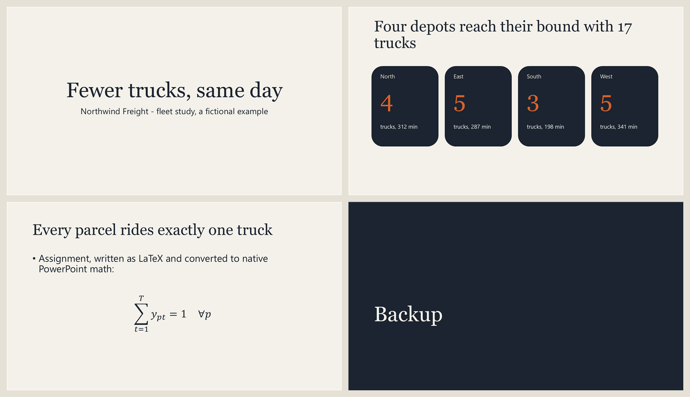
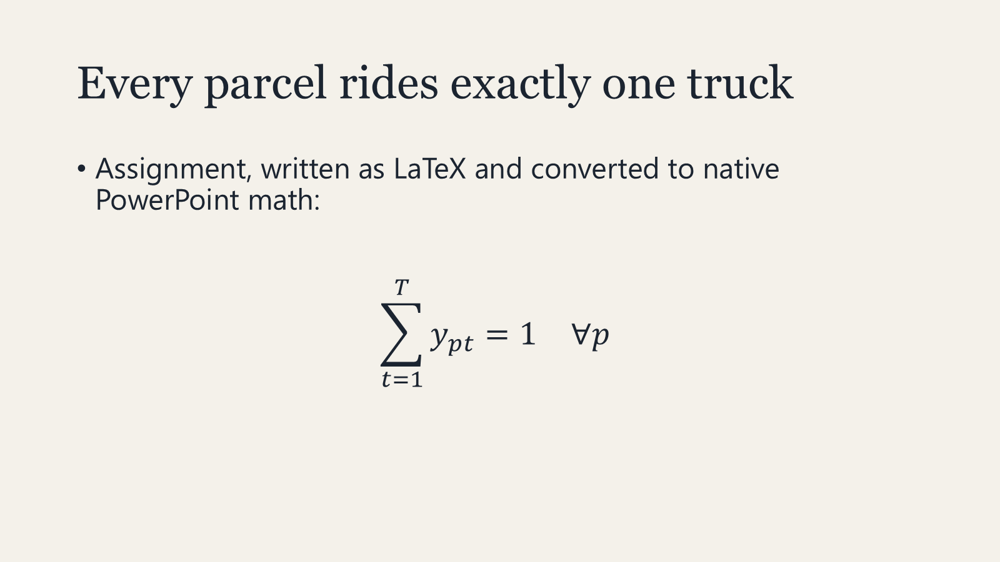
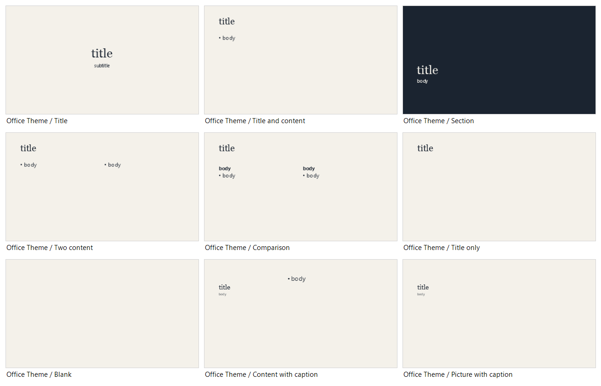

<p align="center">
  <picture>
    <source media="(prefers-color-scheme: dark)" srcset="docs/logo/decks-mark-dark.svg">
    
  </picture>
</p>

<h1 align="center">decks</h1>

<p align="center"><i>the last version</i></p>

<p align="center">
  <a href="https://github.com/TheMattHub/decks/actions/workflows/tests.yml"></a>
  <a href="LICENSE"></a>
  <a href="https://agentskills.io"></a>
</p>

An agent skill for making presentations, packaged as a Claude Code plugin. It takes a deck from a short brief to the file you present: a structure chosen by the kind of talk (consultancy, research, marketing, internal), the story and look drafted in Claude Slides or on your company template, and a native PowerPoint file finished and edited with PowerPoint itself, so videos, transitions, build-ins, fonts and equations stay real and editable.

[](docs/screenshots/marketing-deck.png)

<sub>A fictional marketing deck built by the scripts on a template generated from a palette: pictures cropped to fill, every word editable in PowerPoint.</sub>

## What it does

- **Brief and outline first**: audience, the three messages, a slide budget (about one main slide per minute, the rest in a backup section), and an outline you approve before any slide is built.
- **One path, one source**: design in Claude Slides then finish in PowerPoint, or build on a template; once someone edits the .pptx by hand, it is changed in place by scripts and never regenerated.
- **Templates**: register your company's .pptx/.potx, see its layouts as a picture, fill its placeholders, reuse its designed slides as a library, or generate a new template from colours and fonts.
- **Editable slides**: tables, cards and steps as native elements, equations as native PowerPoint math from LaTeX, charts as images regenerated from data.
- **Review and size**: a leftover check (placeholders, TODOs, file paths), slide renders scored on content, design and coherence, and a media report with a compressed copy.

## Example decks

Two fictional decks in two styles, both rebuilt from scripts in [`examples/`](examples/): a warm, image-led **marketing** deck, and a clean, data-led **consultancy** deck with a native equation.

<table>
<tr>
<td width="50%" valign="top" align="center">
<a href="docs/screenshots/marketing-cover.png"></a>
<br><sub><b>Marketing</b>: full-bleed pictures, warm palette</sub>
</td>
<td width="50%" valign="top" align="center">
<a href="docs/screenshots/demo-deck.png"></a>
<br><sub><b>Consultancy</b>: big numbers, native equation</sub>
</td>
</tr>
<tr>
<td width="50%" valign="top" align="center">
<a href="docs/screenshots/equation-slide.png"></a>
<br><sub><b>Equations</b>: LaTeX in, native PowerPoint math out</sub>
</td>
<td width="50%" valign="top" align="center">
<a href="docs/screenshots/layout-sheet.png"></a>
<br><sub><b>Layout sheet</b>: every layout of a template, slots named</sub>
</td>
</tr>
</table>

## Install

Claude Code:

```powershell
claude plugin marketplace add TheMattHub/decks
claude plugin install decks@themathub-decks
```

Other agents that read Agent Skills (`SKILL.md`), such as Codex CLI, Gemini CLI, GitHub Copilot or OpenCode: copy `skills/making-presentations` into the agent's skills folder (for example `~/.agents/skills/`). The skill and its scripts are self-contained in that folder. The Claude Slides step needs Claude; with another agent, use the template path or build the deck through the scripts.

Requirements: Windows with PowerPoint for the COM helpers (`PptxCom.ps1`, PowerShell 5.1 or 7); [uv](https://docs.astral.sh/uv/) for the Python scripts, which fetch their own dependencies (including ffmpeg for video compression). The equation script uses `MML2OMML.XSL`, which comes with Microsoft Office.

## Templates

Template paths live in `~/.claude/decks.json`, outside any repository, so company files are never committed:

```json
{
  "templates": {
    "acme": { "path": "C:\\path\\to\\Template Acme.pptx", "use": "client and marketing decks" }
  }
}
```

Then ask for a deck "on the acme template". To make a template from a look you like (a Claude Slides deck, another AI tool's output, a brand page), ask for one: the agent reads the colours and fonts and writes a .potx with `New-TemplateFromTheme`.

## Use

Ask for a presentation, a shorter version of one, or changes to a deck. The skill writes a brief, shows you the outline, then follows one path to the .pptx. [SKILL.md](skills/making-presentations/SKILL.md) has the workflow.

## Contents

| Path (under `skills/making-presentations/`) | Holds |
| --- | --- |
| `SKILL.md` | The workflow: brief, path, design, finishing, templates, review, editable slides |
| `references/structures.md` | Slide skeletons for consultancy, research, marketing and internal decks |
| `references/claude-slides.md` | Working with a Claude Slides deck, and what its PowerPoint export keeps |
| `references/powerpoint.md` | Finishing and in-place editing with PowerPoint, equations, media size, gotchas |
| `scripts/PptxCom.ps1` | PowerShell helpers for PowerPoint COM: find by text, videos, transitions, build-ins, fonts, renders, dumps, leftover check, layout sheet, templates, slide library |
| `scripts/pptx_media.py` | Media report and a compressed copy of a .pptx |
| `scripts/pptx_equations.py` | `$$latex$$` paragraphs in a .pptx to native, editable equations |

The logo is drawn by `docs/logo/build_logo.py` (mark, icons, avatar and social preview). `examples/build_marketing_demo.ps1` and `examples/build_demo.ps1` build the example templates, decks and the images above from fictional content; `examples/make_art.py` draws the illustrations.

## Contributing

Questions and ideas go to [Discussions](https://github.com/TheMattHub/decks/discussions); bugs to issues. Read [CONTRIBUTING.md](CONTRIBUTING.md) before a pull request: it says what fits this plugin and what belongs in your fork.

## License

[MIT](LICENSE) © 2026 Matteo Brunetti
